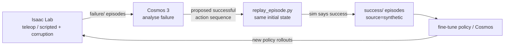

# Cosmos 3 side of the loop

This folder is the hand-off point between the simulator and Cosmos 3. Nothing here runs Cosmos yet;
it documents how the recorded episodes map onto what Cosmos 3 expects, so the conversion and
inference scripts can be written against a fixed contract.

## What the simulator produces

Every episode directory (see `src/panda_al/episode_io.py` for the full spec):

| file | content |
| --- | --- |
| `videos/exterior_1.mp4`, `exterior_2.mp4`, `wrist.mp4`, `wrist_right.mp4` | 640x360 H.264, 15 fps, one frame per row of `data.npz` (`wrist`/`wrist_right` = ZED mini left/right) |
| `videos/wrist_depth.mkv` | lossless 16-bit depth of `wrist` in mm (0 = invalid), `Episode.read_depth("wrist")` |
| `data.npz` → `action` | `(T, 8)` absolute joint position targets (7) + gripper command (0 open … 1 closed) |
| `data.npz` → `joint_position`, `gripper_position`, `cartesian_position`, … | proprioceptive state per frame |
| `meta.json` | task, language instruction, outcome (`success`/`failure`), termination terms, injected corruption |
| `initial_state.npz` | exact simulator state at `t = 0`, used by `scripts/replay_episode.py` |

Row `t` pairs the observation before the action with `action[t]` (DROID convention). The last row
is the terminal observation and should not be used as a training sample.

## How this lines up with Cosmos 3

From the public Cosmos 3 material (as of Oct 2026):

* The released action policies (`nvidia/Cosmos3-Edge-Policy-DROID`, the Nano DROID policy) are
  post-trained on **DROID, i.e. a Franka Panda**.
* The DROID post-training recipe in [cosmos-framework](https://github.com/NVIDIA/cosmos-framework)
  (`docs/action_policy_droid_posttrain.md`) uses **LeRobotDataset v3.0**, **640x360** video,
  `action_space=joint_pos` = **absolute joint positions, 8-D including the gripper**,
  `use_state=true`, action chunks of 32, and a `success/` sub-directory.
* Cosmos 3 supports forward dynamics (actions → video), inverse dynamics (video → actions) and
  policy mode (observation + instruction → actions + predicted video).

The episode format was chosen to match: same robot, same 8-D absolute joint-position action space,
same resolution, DROID's 15 Hz control rate, two exterior views plus a wrist view.

Not verified yet, and to check against the cosmos-framework loader before converting:

* the exact LeRobot feature names / camera keys and the `concat_view` layout the DROID loader expects;
* the gripper convention (DROID uses a Robotiq gripper, 0 = open, 1 = closed; ours is the Panda hand
  with the same 0/1 convention but binary in simulation);
* whether the loader needs the fps and frame counts to match DROID exactly.

## The active-learning loop



1. **Collect failures** - `./al.sh generate --corrupt_ratio 1.0 ...` or teleop episodes labelled `f`.
2. **Generate a fix with Cosmos** - e.g. policy mode conditioned on the failed episode's first frame(s)
   and instruction, or inverse dynamics on a generated "successful" video. Write the result as a
   `(T, 8)` `.npy` in the action format above.
3. **Validate in simulation** - replay the proposed actions from the failed episode's exact initial state:

   ```bash
   ./al.sh replay --episodes data/episodes/<run>/failure/<id> --actions cosmos_actions.npy \
       --source synthetic --run_name cosmos_iter1
   ```

   The replay is recorded like any other episode (real simulator video, `parent_episode` set), and
   only lands in `success/` if the simulator's success check passes. This keeps physically impossible
   generations out of the training set.
4. **Fine-tune** on the validated synthetic successes (plus the real ones) and repeat with the
   improved policy's rollouts.

## Hardware

* **H100 server**: Cosmos inference and post-training. H100s have no RT cores, so Isaac Sim's RTX
  camera rendering is not supported there - run the simulator on the RTX cards.
* **2x RTX A6000 workstation / RTX 5070 Ti**: simulator, episode generation, replay. The 16 GB of
  the 5070 Ti is enough for the simulator with a few parallel envs but not for Cosmos 3 Nano (16B).
